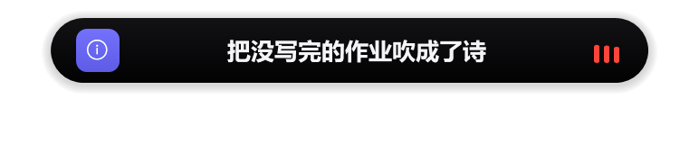
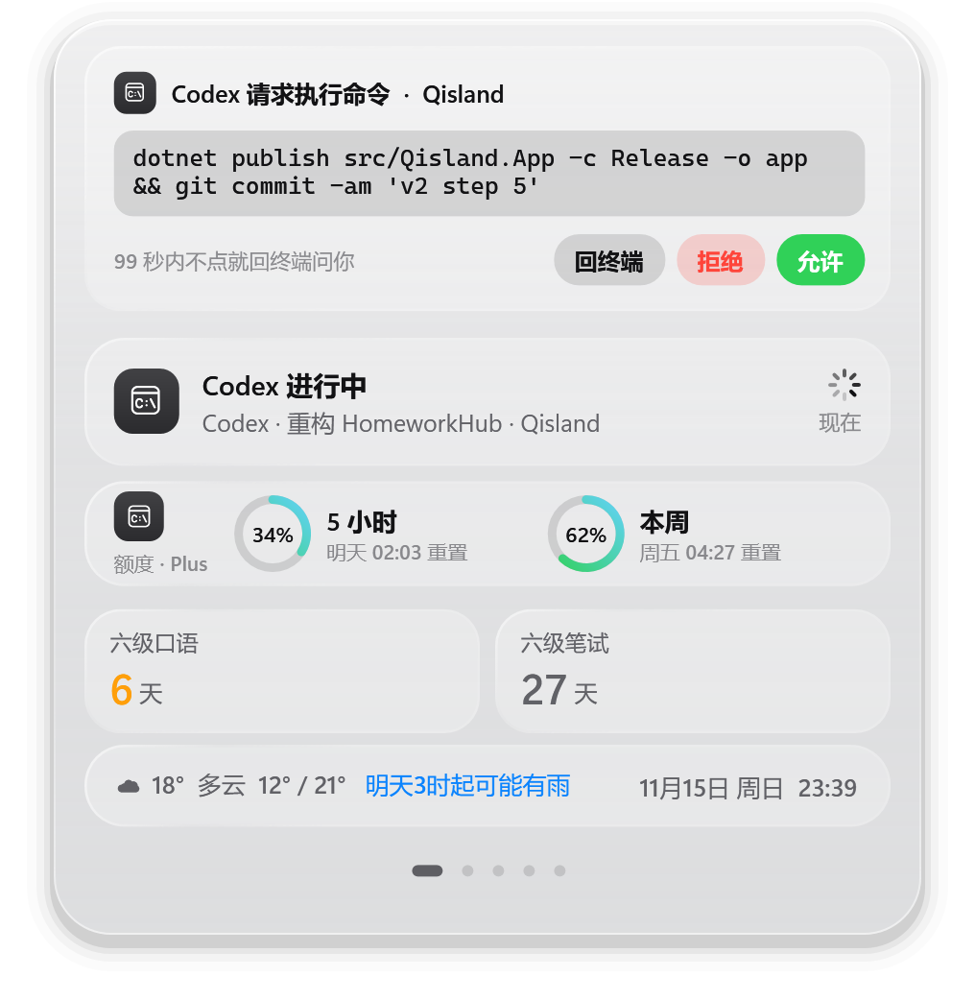

<div align="center">


# Qisland

**事情需要你的时候，它在屏幕顶上告诉你；不需要的时候，它只是一个时钟。**


[下载 v3.0.0](https://github.com/Qiuizi/Qisland/releases/latest) · [宣传片](docs/media/qisland-v3.mp4) · [介绍页](https://qiuizi.github.io/Qisland/) · [v3 更新说明](docs/release-notes-v3.0.0.md)

</div>

---

Qisland 是给 Windows 做的「灵动岛」。它最早是为一个大学生自己写的：课在哪上、作业几点截止、Agent 跑完没有、谁在用麦克风——这些答案都很短，却总要切窗口去看。Qisland 把它们收进屏幕顶上的一颗胶囊：平时只显示时间，有事才变形，事情过去就缩回去。

## 三个出发点

**为学生日常而做。** 导入课表，课前提醒、上课显示进度和教室；雨课堂、学习通扫码登录后只读作业截止时间，截止前 24 / 3 / 1 小时各提醒一次，交了就不再吵。再订阅一份 .ics 日历，组会和面试也一起排进来。

**常驻但不打扰。** 胶囊以外的地方照常点击；全屏游戏和视频里自动让开，但从屏幕顶边仍能把它叫出来。各类监听都靠系统通知驱动，不轮询。下面是作者这台机器（Windows 11、4K、120 Hz）上从 `/v1/perf` 读到的数：

| 项目 | 实测 |
|---|---|
| 空闲时 CPU（30 秒平均） | 约 0.2–0.3% |
| 私有内存 | 约 240 MB（WPF + 玻璃外观，不算小） |
| 线程 / 句柄 | 约 60–75 / 约 1000 |

30 秒平均 CPU 超过 3% 时，性能护栏会自动降级（60 fps、频谱静止、玻璃少截屏），回落后恢复。数字只代表这一台机器，欢迎贴出你的。

**来去干净。** Qisland 只在两处改过别的软件：Codex 的 `~/.codex/hooks.json` 和 DeepSeek Harness 的桥接插件。每一处都记在「改动账本」里（托盘 → 对其他软件的改动），一键还原，只删自己加的那几条，改前先备份。自己的数据全在 `%APPDATA%\Qisland\`；卸载时先在托盘关掉开机自启（它是一个名为 Qisland 的计划任务），再删掉程序和这个文件夹即可。

## 能做什么

<!-- 截图占位：docs/assets/shots/20-agenda.png（课程组件里的日程卡片） -->
<!-- 截图占位：docs/assets/shots/21-call.png（通话中胶囊） -->
<!-- 截图占位：docs/assets/shots/22-privacy-dots.png（麦克风 / 摄像头圆点） -->

**学习**
- 课表 `.ics`：课前 10 分钟提醒，上课时显示进度，首页列出今天剩下的课。
- 作业雷达：雨课堂、学习通的截止时间，分 24 / 3 / 1 小时三档提醒，已交未批改单独列出，登录快过期会提前说。
- 日历订阅：Outlook、Google、飞书、钉钉的 .ics 私密链接；开始前 10 分钟提醒，腾讯会议 / Zoom / Teams / Meet / 飞书 / 钉钉链接一键加入；支持每天、每周、每月（如「第二个周二」「最后一天」）、每年重复。

**AI Agent**
- 审批上岛：Codex 和 DeepSeek Harness 要你批准命令时，岛上直接点允许或拒绝；100 秒没点或岛没开，就照常回终端问你，从不默认同意。
- 状态：Claude Code、Codex、DeepSeek Harness、豆包、Trae、WorkBuddy 跑完、出错、等你确认时，胶囊会变；Codex 额度显示在旁边。
- 点哪跳哪：点一条活动，直接切到对应的终端、会话或作业网页。

**像 Mac 一样的小事**
- 麦克风 / 摄像头被谁占用：开始时提示一下，用着时时间旁边留一个橙点 / 绿点。
- 通话和会议：微信、QQ、腾讯会议、钉钉、飞书、Teams、Zoom 通话时显示「通话中 · 时长」，点一下回到通话窗口。
- 专注：自己的专注计时或 Windows 11 专注会话期间，只放行审批、通话和一小时内截止的作业，结束后汇成一条摘要。
- 蓝牙耳机连上 / 断开和电量；断网、换 Wi-Fi、校园网需要认证、系统代理开关；大写 / 数字锁定。
- 音乐：接入系统媒体控制（SMTC）的音乐软件和浏览器视频，封面、进度、逐行歌词都在岛上，可暂停和切歌。
- 通知里的验证码一键复制；天气、待办、剪贴板、倒计时、文件架等组件，开哪些、怎么排自己定。

托盘「岛上提示」里每一类都能单独关掉。

## 看起来是这样

| 有事时 | 展开后 |
|---|---|
| <br><br> |  |
| **Codex 审批** | **作业截止** |
|  |  |

截图由程序自己的 `--snapshot` 模式用演示数据渲染。完整演示见 [宣传片](docs/media/qisland-v3.mp4)。

## 隐私与边界

- 全在本机，没有服务器，不上传任何东西。
- 不读微信消息内容，只看到「有新消息」这件事。
- 不存任何密码。雨课堂、学习通只用扫码登录，登录凭据用 Windows DPAPI 加密保存；只读作业，不签到、不刷课、不答题，低频拉取。
- 验证码和剪贴板历史只在内存里，不写日志。
- 音乐软件的播放日志只读不写。
- 本机接口只监听 `127.0.0.1`。
- 不碰 Claude Code 的 `~/.claude/settings.json`；Claude 的 hook 脚本需要你自己运行，Qisland 不会代劳。

## 安装

需要 Windows 10 或 11 和 [.NET 8 桌面运行时](https://dotnet.microsoft.com/download/dotnet/8.0)。从 [Releases](https://github.com/Qiuizi/Qisland/releases/latest) 下载压缩包，解压后运行 `Qisland.exe`。有新版时岛上会提示，点一下自动更新。

- Codex 审批：托盘 → Codex → 「在岛上批准 Codex 请求」，或运行 `scripts\install-codex-hooks.ps1`。
- DeepSeek Harness：装上 [integrations/dsh-qisland-bridge](integrations/dsh-qisland-bridge)，见 [docs/deepseek-harness.md](docs/deepseek-harness.md)。
- Claude Code：`scripts\install-claude-hooks.ps1`；WSL2 里用 `scripts/qisland-push`。
- 豆包、Trae、WorkBuddy 不用装：它们的系统通知会被岛接住。

## 用法

- 鼠标移上去展开，移开收起；滚轮切换主页、组件、待办、剪贴板、文件架。
- `Ctrl+Alt+Q`：全屏时把岛叫回来，平时临时隐藏；也可以把鼠标推到屏幕顶边。
- 托盘右键：导入课表、扫码登录、日历订阅、岛上提示开关、外观、开机自启、改动账本。
- 配置都是 `%APPDATA%\Qisland\` 下的纯文本（`todo.md`、`widgets.txt`、`countdown.txt` 等），可以直接改。

## Island API

本机 `http://127.0.0.1:9840`，无需鉴权（只接受本机连接）。

```bash
# 推一张卡片（同 id 再推就是更新）
curl -X POST http://127.0.0.1:9840/v1/island/push \
  -d '{"id":"build","title":"构建中","body":"step 3/5","progress":0.6,"type":"info","priority":"normal","duration_seconds":30,"open_uri":"https://example.com"}'

# 收回
curl -X DELETE http://127.0.0.1:9840/v1/island/push/build
```

| 接口 | 作用 |
|---|---|
| `POST /v1/island/push` | 推送或更新卡片。必填 `title`；可选 `id`、`body`、`subtitle`、`icon`、`type`（info / success / warning / error）、`priority`（low / normal / high）、`progress`（0–1 或 0–100）、`duration_seconds`、`open_uri`、`source` |
| `DELETE /v1/island/push/{id}` | 移除卡片 |
| `POST /v1/agent/{来源}` | Agent hook 事件（Claude Code / Codex 脚本在用） |
| `GET /v1/status` | 健康检查 |
| `GET /v1/perf` | CPU、内存、帧率、各监听器的事件计数 |

更多见 [docs/push-api.md](docs/push-api.md)。

## 已知限制

- 微信 / QQ 新版的来电窗口标题没逐一核对，来电提醒可能认不出（接通后的「通话中」不受影响）。
- 蓝牙电量只有通过免提协议上报电量的耳机才有。
- 笔记本亮度键由固件处理，系统亮度弹窗屏蔽不掉。
- 雨课堂、学习通改版时可能读不到作业，只影响这一项。
- 玻璃外观靠定时截屏模糊，背后画面变化快时会稍有滞后。
- 只在少数几台机器上测过，遇到问题欢迎提 [Issue](https://github.com/Qiuizi/Qisland/issues)。

## 构建

```powershell
git clone https://github.com/Qiuizi/Qisland.git
cd Qisland
dotnet publish src\Qisland.App\Qisland.App.csproj -c Release -r win-x64 --self-contained false -o app
dotnet test tests\Qisland.Core.Tests
```

`src/Qisland.App` 是主程序，`src/Qisland.Core` 是不依赖 WPF 的解析和数据模型（课表 / 日历重复规则、验证码等，带单元测试）。

## 致谢

基于 [JudeKwong/WinIslands](https://github.com/JudeKwong/WinIslands)（MIT）起步，交互参考了 [souverth/dynamic-island-4win](https://github.com/souverth/dynamic-island-4win) 和 [FlorianButz/DynamicWin](https://github.com/FlorianButz/DynamicWin)。MIT 许可，见 [LICENSE](LICENSE)。
