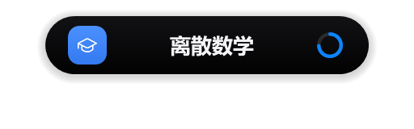
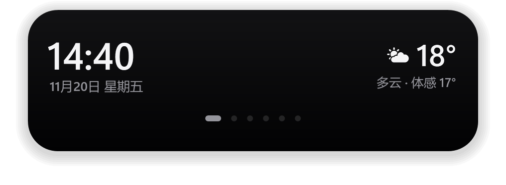

<div align="center">


# Qisland

**事情需要你的时候，它在屏幕顶上告诉你；不需要的时候，它不存在。**


[下载 v2.0.3](https://github.com/Qiuizi/Qisland/releases/latest) · [宣传片](docs/assets/qisland-v2.mp4) · [介绍页](https://qiuizi.github.io/Qisland/)

</div>

---

## 从一个问题出发

一天里你切了多少次窗口，只是为了确认一件事：**有没有什么在等我？**

Agent 跑完了吗？要我批准命令吗？谁发了消息？下节课几点、在哪？作业是不是今晚截止？这些问题的答案都很短，但每问一次都要打断手上的事。

所以根本矛盾不是「信息不够」，而是**注意力被拿去轮询**。Qisland 只做一件事：把这些短答案收进屏幕顶上的一颗胶囊，按重要程度决定它该多安静。

## 它解决的痛点

| 痛点 | Qisland 怎么做 |
|---|---|
| **等 AI Agent，要一直切回去看** | 主流 Agent 都适配：Claude Code、Codex、DeepSeek Harness（DSH）、豆包、Trae、WorkBuddy。跑完、出错、等你确认时，胶囊会变。Codex 和 DeepSeek Harness 的审批可以直接在岛上点允许或拒绝，旁边一圈显示额度还剩多少 |
| **通知要么太吵，要么会漏** | 分四档：可以不管的什么都不做；微信和 QQ 消息只让胶囊轻弹一下、换上发消息软件的图标；时间敏感的展开几秒；必须处理的才停留 |
| **课表、作业截止散在三个 App 里** | 导入课表 `.ics`，课前 10 分钟提醒，上课时显示进度；雨课堂、学习通扫码登录后只读取作业截止时间，24 小时内上岛，3 小时内变红 |
| **想看一眼在放什么，要把播放器翻出来** | 主流音乐平台都适配：QQ 音乐、网易云、酷狗、酷我、Spotify、Apple Music，以及浏览器里的视频。封面、进度和逐行歌词都在岛上，也能直接暂停和切歌 |
| **想要的组件和别人不一样** | 天气、待办、剪贴板、日历、专注、系统状态都是小组件，开哪些、怎么排自己定，在岛上点「编辑组件」就能改 |
| **常驻的东西自己成了负担** | 只有胶囊本身能点，旁边照常点击；打游戏和全屏视频时自动隐藏；闲置约 0.5% CPU（玻璃外观背后画面不变时不重画）；120 Hz 屏上动画跑到 99–118 帧 |
| **怕它碰隐私** | 全在本机。不存任何密码，登录凭据用 Windows DPAPI 加密；不读微信消息内容；不自动签到、刷课或答题；剪贴板历史只在内存里 |

## 看起来是这样

| 有事时 | 展开后 |
|---|---|
| <br><br> |  |
| **Codex 审批** | **作业截止** |
|  |  |

截图由程序自己的 `--snapshot` 模式用演示数据渲染。

## 安装

需要 Windows 10 或 11，以及 [.NET 8 桌面运行时](https://dotnet.microsoft.com/download/dotnet/8.0)。从 [Releases](https://github.com/Qiuizi/Qisland/releases/latest) 下载压缩包，解压后运行 `Qisland.exe`。之后有新版时，岛上会提示，点一下就自动更新。

接上 Codex：

```powershell
powershell -ExecutionPolicy Bypass -File scripts\install-codex-hooks.ps1
```

Claude Code 用 `scripts\install-claude-hooks.ps1`，WSL2 里用 `scripts/qisland-push`。豆包、Trae、WorkBuddy 不用装任何东西：它们弹出的系统通知会被岛接住，按「完成 / 等你确认 / 出错」显示。DeepSeek Harness 装上 [integrations/dsh-qisland-bridge](integrations/dsh-qisland-bridge) 插件后，审批会先弹到岛上，点允许、拒绝或「回 DSH」，岛没开或 100 秒没点就照常在 DSH 里问，详见 [docs/deepseek-harness.md](docs/deepseek-harness.md)。别的程序想上岛，可以往本机 `http://127.0.0.1:9840` 发一个请求，协议见 [docs/push-api.md](docs/push-api.md)。

## 用法

- 鼠标移上去展开，移开收起；滚轮切换主页、组件、待办、剪贴板、文件架。
- `Ctrl+Alt+Q`：全屏时把岛叫回来，平时临时隐藏。
- 托盘右键：导入课表、登录雨课堂和学习通、切换外观、开机自启、接管音量键。
- 组件页底部点「编辑组件」：开关每个组件、上下调整顺序；相邻的两个半宽组件会并排。
- 配置都是 `%APPDATA%\Qisland\` 下的纯文本，比如 `todo.md`、`widgets.txt`、`countdown.txt`、`fullscreen.txt`，可以直接改。

## 已知限制

- 笔记本的亮度键由固件处理，系统亮度弹窗屏蔽不掉。
- 雨课堂和学习通改版时可能读不到作业，只影响这一项。
- 玻璃外观靠定时截屏模糊，背后画面变化很快时会稍有滞后；岛收起时约每秒刷新 4 次，展开和动画时每秒 20 次。
- 只在少数几台机器上测过，遇到问题欢迎提 [Issue](https://github.com/Qiuizi/Qisland/issues)。

## 构建

```powershell
git clone https://github.com/Qiuizi/Qisland.git
cd Qisland
dotnet publish src\Qisland.App\Qisland.App.csproj -c Release -r win-x64 --self-contained false -o app
```

`src/Qisland.App` 是主程序，`src/Qisland.Core` 是不依赖 WPF 的解析和数据模型（带单元测试）。发版用 `scripts\release.ps1 <版本号>`。

## 致谢

基于 [JudeKwong/WinIslands](https://github.com/JudeKwong/WinIslands)（MIT）起步，交互参考了 [souverth/dynamic-island-4win](https://github.com/souverth/dynamic-island-4win) 和 [FlorianButz/DynamicWin](https://github.com/FlorianButz/DynamicWin)。MIT 许可，见 [LICENSE](LICENSE)。
