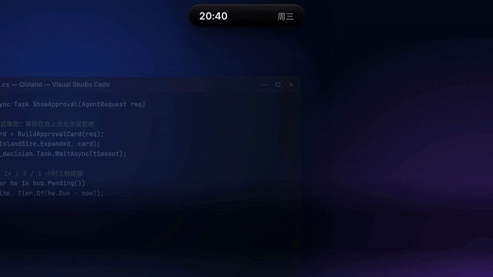
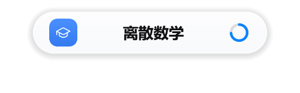
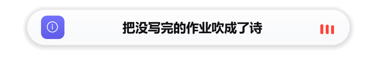
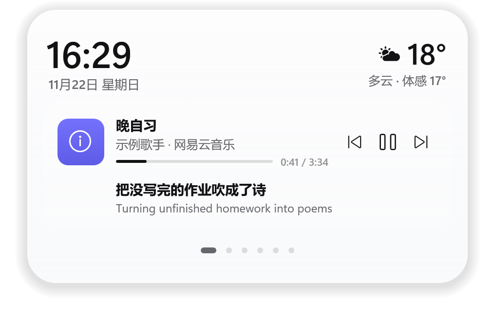
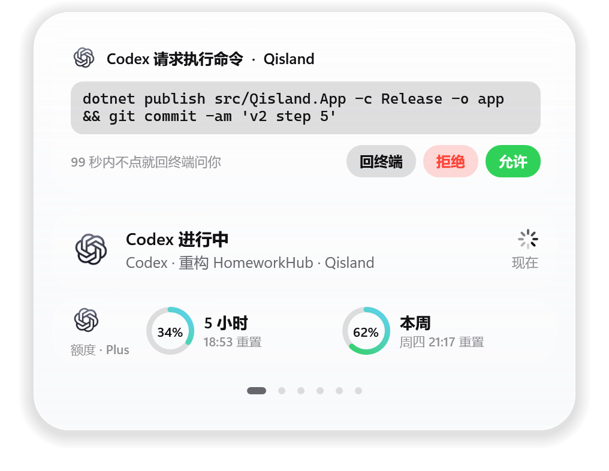
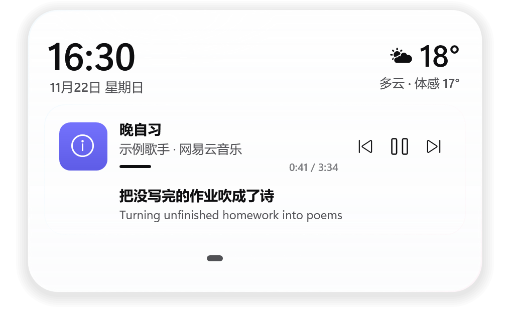

<div align="center">



# Qisland

**该知道的，抬眼就知道。**


[下载 v4.1.0](https://github.com/Qiuizi/Qisland/releases/tag/v4.1.0) · [宣传片](docs/assets/media/qisland-4.1.mp4) · [介绍页](https://qiuizi.github.io/Qisland/) · [更新日志](CHANGELOG.md)

</div>

---

Qisland 是给 Windows 做的「灵动岛」。它最早是为一个大学生自己写的：课在哪上、作业几点截止、Agent 跑完没有、谁在用麦克风——这些答案都很短，却总要切窗口去看。Qisland 把它们收进屏幕顶上的一颗胶囊：平时只显示时间，有事才展开，事情过去就收回去。

4.1.0 是 4.0.0 之后的一轮稳定性更新：自动更新失败可以回滚，本机接口可选用 Token，作业和日历在解析失败时保留旧数据。明细见 [更新日志](CHANGELOG.md)。

## 三个出发点

**为学生日常而做。** 导入课表，课前提醒、上课显示进度和教室；雨课堂、学习通扫码登录后只读作业截止时间，截止前 24 / 3 / 1 小时各提醒一次，交了就不再吵。再订阅一份 .ics 日历，组会和面试也一起排进来。

**常驻但不打扰。** 胶囊以外的地方照常点击；前台窗口盖满整块屏（全屏游戏、视频，或任务栏自动隐藏时的最大化窗口）就自动让开，把鼠标推到岛正上方的屏幕顶边停一下仍能把它叫出来。各类监听都靠系统通知驱动，不轮询。下面是作者这台机器（Windows 11、4K、120 Hz）上从 `/v1/perf` 读到的数：

| 项目 | 实测 |
|---|---|
| 空闲时 CPU（30 秒平均） | 约 0.2–0.3% |
| 私有内存 | 约 240 MB（WPF + 玻璃外观，不算小） |
| 线程 / 句柄 | 约 60–75 / 约 1000 |

30 秒平均 CPU 超过 3% 时，性能护栏会自动降级（60 fps、频谱静止、玻璃少截屏），回落后恢复。数字只代表这一台机器，欢迎贴出你的。

**来去干净。** Qisland 只在两处改过别的软件：Codex 的 `~/.codex/hooks.json` 和 DeepSeek Harness 的桥接插件。每一处都记在「改动账本」里（托盘 → 对其他软件的改动），一键还原，只删自己加的那几条，改前先备份。自己的数据全在 `%APPDATA%\Qisland\`；卸载时先在托盘关掉开机自启（它是一个名为 Qisland 的计划任务），再删掉程序和这个文件夹即可。

## 能做什么

**外观与手感**
- 两套玻璃皮肤：「磨砂玻璃」用 Windows 系统合成的背景模糊；「液态玻璃」参考 iOS 26——中间几乎透明，左上镜面亮边、内圈斜面、边缘一圈淡磨砂，岛里的卡片、通知列表和按钮也是同一套液态样式。托盘「外观」或设置窗里切换。
- 点一下直达：点岛上任何一条（收起的胶囊也行），直接切到来源软件——系统通知回到发通知的应用，微信 / QQ 回到会话，终端里的 AI 会话回到那个终端，音乐回到播放器或浏览器标签页。
- 岛仔同款弹簧动效，阴影四周均匀；可停在顶部、左侧或右侧，或者用极简模式只留一小段线。
- 统一设置窗（托盘「设置…」）：外观、停靠、提示、天气、健康、日历待办、课程作业、翻译 / AI 一处改完。

**学习**
- 课表 `.ics`：课前 10 分钟提醒，上课时显示进度，首页列出今天剩下的课。
- 作业雷达：雨课堂、学习通的截止时间，分 24 / 3 / 1 小时三档提醒，已交未批改单独列出，登录快过期会提前说。
- 本机日程：月历里直接新建 / 编辑（全天、每周重复、地点）；待办可设提醒时间和每周重复。
- 日历订阅：Outlook、Google、飞书、钉钉的 .ics 私密链接；开始前 10 分钟提醒，腾讯会议 / Zoom / Teams / Meet / 飞书 / 钉钉链接一键加入；支持每天、每周、每月（如「第二个周二」「最后一天」）、每年重复。

**AI Agent**
- 审批上岛：Codex 和 DeepSeek Harness 要你批准命令时，岛上直接点允许或拒绝；100 秒没点或岛没开，就照常回终端问你，从不默认同意。
- 状态：Claude Code、Codex、DeepSeek Harness、豆包、Trae、WorkBuddy 跑完、出错、等你确认时，胶囊会变；Codex 额度显示在旁边。
- 「AI」页：所有 Agent 会话（含 Gemini CLI、Cursor、Qwen Code、OpenCode）的状态和耗时，Codex / 豆包额度环，DeepSeek / Kimi 余额。
- 接入其他工具：托盘「接入其他 AI 工具」里逐个开启，每一个都先弹窗说明改哪个文件、改什么，同意了才改，改前备份、记进改动账本、可还原。

**翻译与 AI**
- 划词翻译（`Ctrl+Alt+T`）：岛上左右对照，可复制、可一键替换原文；默认免 Key 的 MyMemory，也可用豆包（方舟）、DeepSeek、Kimi、通义或本机 Ollama。
- 问 AI（`Ctrl+Alt+K`）：用自己的 Key 在岛上回答，或粘贴到豆包窗口（只粘贴，不发送）。
- 豆包会员额度（非官方接口，自愿连接）：只读，约 25 分钟一次。

**像 Mac 一样的小事**
- 麦克风 / 摄像头被谁占用：开始时提示一下，用着时时间旁边留一个橙点 / 绿点。
- 通话和会议：微信、QQ、腾讯会议、钉钉、飞书、Teams、Zoom 通话时显示「通话中 · 时长」，点一下回到通话窗口。
- 专注：自己的专注计时或 Windows 11 专注会话期间，只放行审批、通话和一小时内截止的作业，结束后汇成一条摘要。
- 蓝牙耳机连上 / 断开和电量；断网、换 Wi-Fi、系统代理开关；大写 / 数字锁定。
- 音乐：接入系统媒体控制（SMTC）的音乐软件和浏览器视频，封面、进度、逐行歌词都在岛上，可暂停和切歌。
- 通知里的验证码一键复制；天气（7 天、最多 5 个地点、天气提醒）、健康（喝水、久坐）、待办、剪贴板（可置顶）、倒计时、文件架等组件，开哪些、怎么排自己定。

托盘「岛上提示」里每一类都能单独关掉。

## 看起来是这样

| 有事时 | 展开后（磨砂玻璃） |
|---|---|
| <br><br> |  |
| **Codex 审批** | **展开后（液态玻璃）** |
|  |  |

截图由程序自己的 `--snapshot` 模式用演示数据渲染，磨砂玻璃和液态玻璃各有一套。完整演示见 [宣传片](docs/assets/media/qisland-4.1.mp4)。

## 隐私与边界

- 全在本机，没有服务器，不上传任何东西。
- 不读微信消息内容，只看到「有新消息」这件事。
- 不存任何密码。雨课堂、学习通只用扫码登录，登录凭据用 Windows DPAPI 加密保存；只读作业，不签到、不刷课、不答题，低频拉取。
- 验证码和剪贴板历史只在内存里，不写日志。
- 划词翻译 / 问 AI 的原文和结果只在内存里；没有选中时只替你按一次 Ctrl+C 并还原剪贴板，焦点在密码框或终端里时不按。API Key 存在 Windows 凭据管理器，不写配置、不写日志。
- 豆包额度用你自己粘贴的 Cookie（DPAPI 加密），只读额度，登录失效就停，不反复重试。
- 酷狗、汽水音乐的本机歌词缓存只读不写。
- 音乐软件的播放日志只读不写。
- 本机接口只监听 `127.0.0.1`。
- 不碰 Claude Code 的 `~/.claude/settings.json`；Claude 的 hook 脚本需要你自己运行，Qisland 不会代劳。

## 安装

需要 Windows 10 或 11 和 [.NET 8 桌面运行时](https://dotnet.microsoft.com/download/dotnet/8.0)。从 [v4.1.0 Release](https://github.com/Qiuizi/Qisland/releases/tag/v4.1.0) 下载 `Qisland-4.1.0-win-x64.zip`，解压后运行 `Qisland.exe`。有新版时岛上会提示，点一下自动更新；更新失败会回滚到旧版。

- Codex 审批：托盘 → Codex → 「在岛上批准 Codex 请求」，或运行 `scripts\install-codex-hooks.ps1`。
- DeepSeek Harness：装上 [integrations/dsh-qisland-bridge](integrations/dsh-qisland-bridge)，见 [docs/deepseek-harness.md](docs/deepseek-harness.md)。
- Claude Code：`scripts\install-claude-hooks.ps1`；WSL2 里用 `scripts/qisland-push`。装了之后，等你确认时岛上会弹出提示，但不能在岛上点审批（能点允许 / 拒绝的只有 Codex 和 DeepSeek Harness）。
- 豆包、Trae、WorkBuddy 不用装：它们的系统通知会被岛接住。

## 用法

- 鼠标移上去展开，移开收起；滚轮切换主页、组件、待办、剪贴板、文件架、AI。
- `Ctrl+Alt+T` 翻译选中文字，`Ctrl+Alt+K` 问 AI；托盘「翻译与 AI」里可关掉或改快捷键、填 Key。
- `Ctrl+Alt+Q`：全屏时把岛叫回来，平时临时隐藏；也可以把鼠标推到岛正上方的屏幕顶边停一下。
- 托盘右键：设置、导入课表、扫码登录、日历订阅、岛上提示开关、外观、停靠、动效、开机自启、改动账本。
- 配置都是 `%APPDATA%\Qisland\` 下的纯文本（`todo.md`、`widgets.txt`、`countdown.txt` 等），可以直接改。
- 天气地点写在 `weather.txt`（一行一个：地名 经度,纬度），留空就按网络位置自动判断；雨课堂如果用的是专属域名，写进 `yuketang-host.txt`。

## Island API

本机 `http://127.0.0.1:9840`，只接受本机连接。默认无需鉴权。若在 `%APPDATA%\Qisland\api-token.txt` 里写了 Token，除健康检查外的普通请求要带 `X-Qisland-Token`。

```bash
# 推一张卡片（同 id 再推就是更新）
curl -X POST http://127.0.0.1:9840/v1/island/push \
  -d '{"id":"build","title":"构建中","body":"step 3/5","progress":0.6,"type":"info","priority":"normal","duration_seconds":30,"open_uri":"https://example.com"}'

# 收回
curl -X DELETE http://127.0.0.1:9840/v1/island/push/build
```

| 接口 | 作用 |
|---|---|
| `POST /v1/island/push` | 推送或更新卡片。必填 `title`；可选 `id`、`body`、`subtitle`、`icon`、`type`（info / success / warning / error）、`priority`（low / normal / high）、`progress`（0–1 或 0–100）、`duration_seconds`、`open_uri`、`source`。外部推送放在 `ext:` 命名空间，不会覆盖 Qisland 自己的活动 |
| `DELETE /v1/island/push/{id}` | 移除卡片 |
| `GET /v1/island/active` | 只读：当前外部卡片。未配置 Token 时不返回标题和正文 |
| `POST /v1/agent/{来源}` | Agent hook 事件（Claude Code / Codex 脚本在用） |
| `GET /v1/health`（或 `/v1/status`） | 健康检查，不需要 Token |
| `GET /v1/perf` | CPU、内存、帧率、各监听器的事件计数 |

更多见 [docs/push-api.md](docs/push-api.md)。

## 已知限制

- 微信 / QQ 新版的来电窗口标题没逐一核对，来电提醒可能认不出（接通后的「通话中」不受影响）。
- 蓝牙电量只有通过免提协议上报电量的耳机才有。
- 笔记本亮度键由固件处理，系统亮度弹窗屏蔽不掉。
- 雨课堂、学习通改版时可能读不到作业，只影响这一项。
- 学习通的页面结构如果识别不了，可能丢掉旧条目。
- 划词时，同一进程在几毫秒内连续复制两次，可能被误判为选区。
- 液态玻璃的边缘磨砂是几圈叠出来的近似渐变，做不出真正的折射；Win10 上玻璃退回定时截屏模糊，背后画面变化快时会稍有滞后。
- 只在少数几台机器上测过，遇到问题欢迎提 [Issue](https://github.com/Qiuizi/Qisland/issues)。

## 构建

```powershell
git clone https://github.com/Qiuizi/Qisland.git
cd Qisland
dotnet publish src\Qisland.App\Qisland.App.csproj -c Release -r win-x64 --self-contained false -p:PublishReadyToRun=true -o app
```

`src/Qisland.App` 是主程序，`src/Qisland.Core` 是不依赖 WPF 的解析和数据模型（课表 / 日历重复规则、验证码等）。

## 致谢

v4 的动效、天气、健康、剪贴板置顶、停靠、系统合成玻璃等不少思路来自 [岛仔 Daozai](https://github.com/Renly1994/xiaotang-daozai)（MIT），都是 C# / WPF 自行实现，明细见 [THIRD_PARTY.md](THIRD_PARTY.md)。基于 [JudeKwong/WinIslands](https://github.com/JudeKwong/WinIslands)（MIT）起步，交互参考了 [souverth/dynamic-island-4win](https://github.com/souverth/dynamic-island-4win) 和 [FlorianButz/DynamicWin](https://github.com/FlorianButz/DynamicWin)。MIT 许可，见 [LICENSE](LICENSE)。
