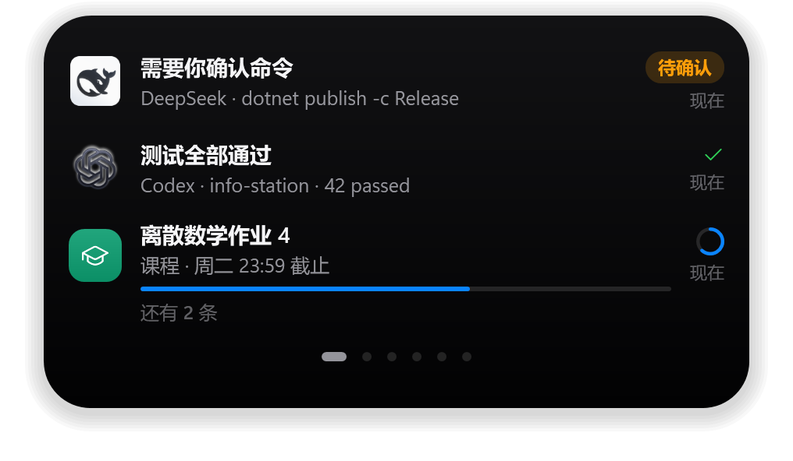
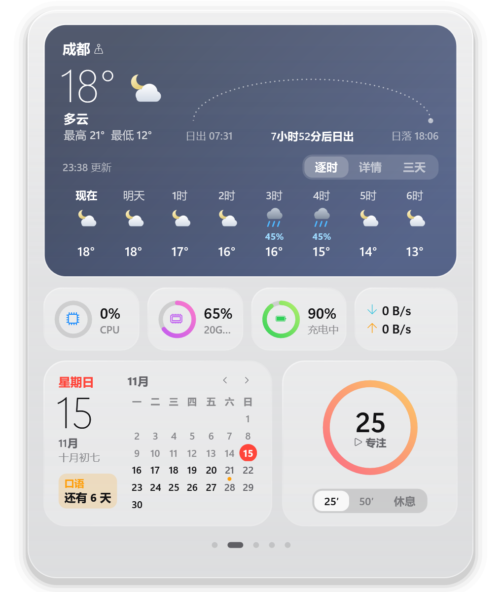
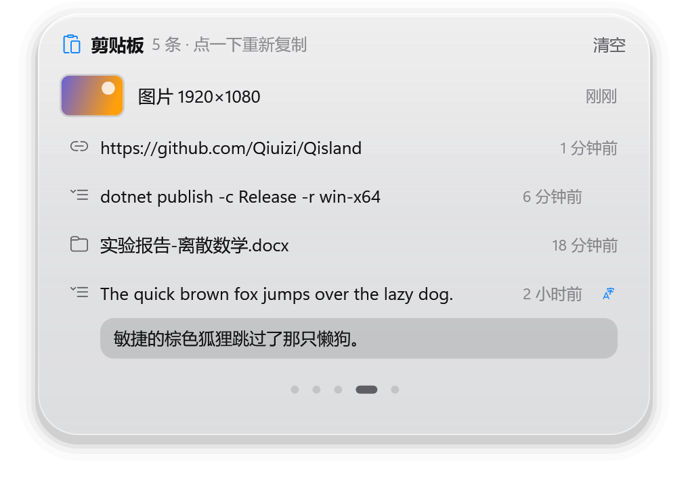
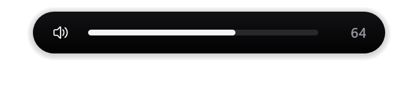

<div align="center">


# Qisland

**给 Windows 做的灵动岛：顺滑、安静，不挡事。**


[介绍页](https://qiuizi.github.io/Qisland/) · [宣传片](docs/assets/qisland-v1-preview.mp4) · [下载 V1 前瞻](https://github.com/Qiuizi/Qisland/releases/tag/v1.0.0-preview)

</div>

---

Windows 上的“灵动岛”项目不少，但真正用一天就会碰到同一批问题：岛下面的东西点不到、打游戏时它浮在画面上、闲着也吃 CPU、动画只有 60 帧、换个显示器就跑偏。Qisland 的 V1 前瞻版先把这些地基打牢，再往上放功能。

## 它解决了哪些痛点

| 痛点 | 常见做法的问题 | Qisland 的做法 |
|---|---|---|
| **岛下面点不到东西** | 透明大窗口盖在屏幕顶上，`WS_EX_TRANSPARENT` 在非分层 DWM 窗口上并不放行点击 | 用 `SetWindowRgn` 把可点击区域收紧到岛本身加一圈阴影，其余像素直接穿透；动画中只扩不缩，停稳再收回，避免逐帧改区域造成闪烁 |
| **打游戏、看全屏视频时挡画面** | 一直置顶，只能手动退出 | 通过 `SHQueryUserNotificationState` 识别全屏 D3D 和演示模式自动隐藏；`Ctrl+Alt+Q` 临时叫回或一键隐藏；`fullscreen.txt` 按进程名写白名单和黑名单 |
| **闲着也耗电** | 每帧轮询、常驻动画 | 闲置时不跑渲染循环，只有弹簧在动时才拉起帧计时。作者机器上实测：闲置约 0.5% CPU，转圈动画约 2.6%，托管堆约 3.4 MB |
| **动画发涩、只有 60 帧** | WPF 默认 60 fps | 读显示器刷新率并覆盖 `Timeline.DesiredFrameRate`，120 Hz 屏上实测约 116 fps；所有尺寸变化走弹簧，页面预热并缓存，滑动不重建 |
| **玻璃效果留下黑块** | Win11 24H2 上亚克力和模糊无法被窗口区域裁切 | 不用系统模糊，改为半透明磨砂填充、边缘高光和分层假阴影，三种外观（深色、白色、液态玻璃）都不会出黑块 |
| **系统音量弹窗又大又丑** | 只能忍 | 接管音量键，在岛上显示音量条，随耳机切换显示设备名；托盘里一键还给系统 |
| **多显示器乱跑** | 固定在主屏，或在高 DPI 副屏上偏移 | 有两块以上屏幕时跟随前台窗口所在的屏，按每块屏自己的 DPI 居中 |
| **程序挂了就没了** | 需要手动重开 | 开机自启，崩溃后自动重启；60 秒内重复崩溃不再拉起，防止死循环 |
| **想看的信息散在各处** | 来回切窗口 | AI 编程助手的确认请求、课程截止、微信和 QQ 消息、媒体、天气、倒计时、待办，按重要程度排进一条胶囊 |

## 截图

| 主页 | 组件 |
|---|---|
|  |  |
| **剪贴板** | **音量** |
|  | <br><br> |

截图由程序自己的 `--snapshot` 模式渲染，内容是演示数据。

## 功能一览

- **五个页面**：主页、组件、待办、剪贴板、文件架，滚轮或圆点切换，收起时回到主页。
- **活动来源**：Claude Code / Codex（官方 hook）、DeepSeek Harness、信息站、CourseDesk、微信和 QQ 通知、媒体（QQ 音乐、Spotify、酷狗、酷我、Apple Music、PotPlayer、VLC、浏览器视频）、天气。
- **系统提示**：插拔电源、电量 20% 和 10% 提醒、充满提醒；耳机连接和输出切换；资源管理器复制、移动、删除进度；浏览器下载进度和速度，完成后点一下在文件夹里定位。
- **剪贴板历史**：最近 30 条文字和文件，只存在内存里，不写硬盘；尊重密码管理器设置的“不进历史”标记。
- **专注计时**：待办旁边点 25′ 开始，结束时岛会展开，问你做完了、再来一轮还是休息。
- **考试倒计时**：三天内的考试会出现在收起状态的胶囊上。
- **上岛 API**：`http://127.0.0.1:9840`，只监听本机，兼容 WinIslands 的 `/v1/island/push`。协议见 [docs/push-api.md](docs/push-api.md)。

## 安装

需要 Windows 10/11 和 [.NET 8 桌面运行时](https://dotnet.microsoft.com/download/dotnet/8.0)。从 [Releases](https://github.com/Qiuizi/Qisland/releases) 下载压缩包，解压后运行 `Qisland.exe`。

自己构建：

```powershell
git clone https://github.com/Qiuizi/Qisland.git
cd Qisland
dotnet publish src\Qisland.App\Qisland.App.csproj -c Release -r win-x64 --self-contained false -p:PublishReadyToRun=true -o app
.\app\Qisland.exe
```

## 快捷键与配置

| 操作 | 方式 |
|---|---|
| 展开 / 收起 | 鼠标移到岛上 / 移开 |
| 换页 | 滚轮，或点下方圆点 |
| 全屏时叫回、平时隐藏 | `Ctrl+Alt+Q` |
| 切换外观、自启、音量键接管 | 托盘图标右键 |

数据都在 `%APPDATA%\Qisland\`，纯文本，可以直接改：

| 文件 | 内容 |
|---|---|
| `todo.md` | 待办，Markdown 复选框格式 |
| `countdown.txt` | 每行一场考试，例如 `2026-12-12 六级笔试 \| 笔试`（竖线后是胶囊上的短标签） |
| `fullscreen.txt` | `show 进程名` 全屏时也显示，`hide 进程名` 前台时总是隐藏 |
| `shelf.txt` | 文件架上的文件 |
| `look.txt` | 外观，建议从托盘菜单切换 |

## 接上编程助手

```powershell
powershell -ExecutionPolicy Bypass -File scripts\install-codex-hooks.ps1
```

Codex 写的是 `%USERPROFILE%\.codex\config.toml` 的 `notify`，已有配置不会被覆盖。Claude Code 的脚本 `scripts\install-claude-hooks.ps1` 也在仓库里，需要时自己运行。WSL2 里的助手可以用 `scripts/qisland-push`。DeepSeek Harness 不需要装任何东西，Qisland 会看它的窗口和系统通知。

## 已知限制

- 笔记本的亮度键由固件处理，系统亮度弹窗无法屏蔽；Qisland 只会在岛上同步显示亮度。
- 复制进度依赖资源管理器对话框标题，下载进度依赖浏览器的临时文件扩展名（`.crdownload`、`.part` 等），非中文系统或小众下载器可能识别不到。
- 液态玻璃外观没有真正的背景模糊，原因见上表。
- 这是 V1 前瞻版，作者每天在用，但只在少数几台机器上测过。欢迎提 Issue。

## 结构

```
src/Qisland.App    新的 WPF 岛（本仓库的主程序，手写，轻量）
src/Qisland.Core   不依赖 WPF 的解析与数据模型，可在 Linux 上测试
src/WinIslands     上游 WinIslands v3.1.2，保留作参考
tests/             Core 的单元测试
docs/              API 文档、介绍页与截图
```

## 致谢与许可

基于 [JudeKwong/WinIslands](https://github.com/JudeKwong/WinIslands)（MIT）起步，交互参考了 [souverth/dynamic-island-4win](https://github.com/souverth/dynamic-island-4win) 和 [FlorianButz/DynamicWin](https://github.com/FlorianButz/DynamicWin)。MIT 许可，见 [LICENSE](LICENSE)。

## 更新与发版

**用户侧**：Qisland 启动 40 秒后、之后每 6 小时检查一次 GitHub Releases（预览版也会收到预览版）。有新版时岛上出现一条「可以更新了」，点一下自动下载、替换、重启，不需要管理员权限；托盘菜单里可以手动「检查更新」或「跳过这个新版本」。

**作者侧**：一条命令发版——改版本号、编译、打包、打 tag、推送、建 Release 全自动：

```powershell
.\scripts\release.ps1 1.0.2-preview "这次改了什么"
.\scripts\release.ps1 1.1.0 -NotesFile notes.md   # 不带 - 的版本号会标成正式版
.\scripts\release.ps1 1.0.2 -DryRun               # 只编译打包，不推送
```