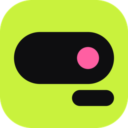
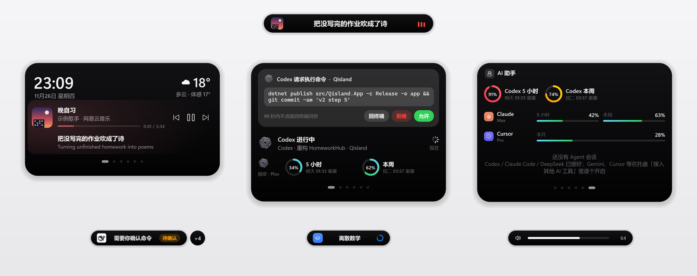
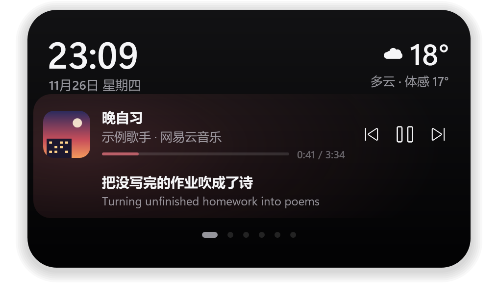
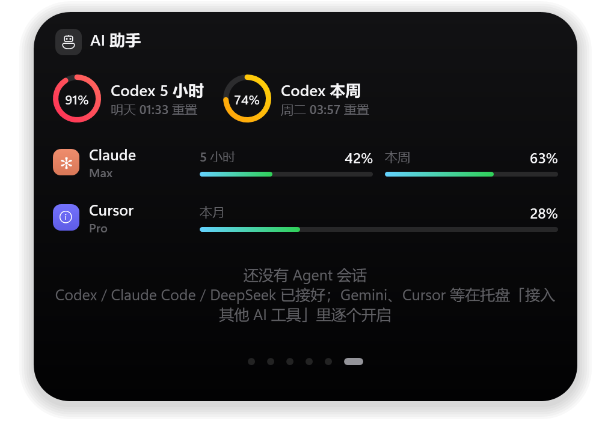

<div align="center">



# Qisland

**面向 Windows 开发者与学生的轻量原生灵动岛。该知道的，抬眼就知道。**


[下载最新版](https://github.com/Qiuizi/Qisland/releases/latest) · [介绍页](https://qiuizi.github.io/Qisland/) · [更新日志](CHANGELOG.md) · [English](README_EN.md)



</div>

---

Qisland 把屏幕顶上的一颗胶囊变成你的状态栏：Agent 要你批准命令、AI 额度快用完、验证码到了、鼠标没电了、作业快截止了，都在这里抬眼就看到；平时只显示时间，有事才展开，事情过去就收回去。原生 .NET 8 / WPF，不带浏览器内核，依赖运行时的安装包约 9 MB，全部在本机运行。

## 亮点

- **Codex / DeepSeek Harness 岛上审批**：它们要执行命令时，岛上直接点「允许」或「拒绝」；100 秒没点就照常回终端问你，从不默认同意。Claude Code 只在岛上显示「等你确认」的提示，不能在岛上审批。
- **多家 AI 编程工具额度**（4.3 新增，默认关）：Codex、豆包之外，可读取本机已登录的 Claude Code、Cursor、Gemini CLI、Kimi Code 的用量百分比，过 70% / 90% 各提醒一次，收起的胶囊上可选一圈小额度环。这几个用量接口没有公开文档，读不到就不显示；Claude Code / Cursor / Gemini CLI / Kimi Code 四家目前只按接口格式做了解析和自检，还没有用真实订阅账号验证。
- **邮箱验证码**（4.3 新增，默认关）：只读 IMAP 收件箱（QQ、163、126、Gmail、iCloud 或自定义服务器），新邮件里的验证码直接上岛、一键复制；不标已读、不删不移，授权码存在 Windows 凭据管理器。目前只用模拟 IMAP 服务器测过。
- **外设电量**（4.3 新增）：蓝牙鼠标、键盘、手柄、耳机的电量，掉到 20% / 10% 提醒；读不到电量的设备不显示。
- **封面取色的音乐卡片**（4.3 新增）：卡片后面垫一层封面主色的柔光，进度条跟着变色，颜色压在不刺眼、不影响看字的范围；切歌有方向感的过渡；歌词带逐字时间时（酷狗本机歌词、增强 LRC）逐字高亮。
- **离线国内天气城市**：国内城市从内置离线表秒搜（搜「海南」直接给海口、三亚），海外城市和预报走 Open-Meteo，免 Key。
- **点击穿透锁定**：`Ctrl+Alt+Shift+Q` 让整座岛不接鼠标，点击和滚轮都落到下面的窗口，通知照常显示。
- **按程序隐藏**：名单里的程序在前台时岛自动让开，可选「只在挡住岛时才藏」；全屏游戏和视频本来就会自动让开。
- **截图录屏时隐藏**（默认关）：截图、录屏、共享屏幕里看不到岛，自己屏幕上照常显示。
- **本地推送 API**：`http://127.0.0.1:9840` 一行 curl 把构建进度、脚本结果推上岛，只监听本机。

## 5.0 预览：DIY、插件和安装包（未发布）

下一版还在开发中，代码在主分支上，还没有发 Release。详细改动见 [更新日志](CHANGELOG.md)。

- **零代码 DIY**：设置里的「布局与 DIY」可以拖动编排收起的胶囊（空闲时和放音乐时各一份）和组件页，带实时预览；`theme.json` 主题包只写想改的字段，导入时校验颜色、对比度和取值范围，附带三套官方主题；组件页可以放最多 12 个快捷按钮。
- **两级插件**：L2 安全卡片只有一个 `plugin.json`，不运行任何代码，联网由 Qisland 代发且只能访问声明过的至多 3 个公网 https 域名；L3 高级插件沿用旧版的进程插件，会运行本机程序、没有沙箱，启用前单独确认。插件更新后要的权限变多会自动暂停，等你重新确认。规范见 [plugins/README.md](plugins/README.md)。
- **插件市场**：内置 6 个官方插件和 3 套主题的离线目录，一键安装 / 应用 / 卸载；在线索引和撤销名单都要用程序内置的公钥验过 Ed25519 签名，命中撤销名单的插件会被停用并写明原因。也可以加第三方源，界面上一直标「第三方源 · 未验签」。索引仓库的模板和投稿流程在 [plugins/registry-template](plugins/registry-template/README.md)，远端仓库还没建。
- **安装包**：除了两个 zip，还会有一个 `Qisland-<版本>-Setup.exe`（Inno Setup），不要管理员权限，默认装到 `%LOCALAPPDATA%\Programs\Qisland`，可选桌面快捷方式和开机自启，卸载时默认保留你的设置。

这些都只过了编译、自检和离屏截图：真机上的拖动手感、导入对话框、插件请求真实接口、市场在线刷新和下载、Setup.exe 的实际安装 / 升级 / 卸载还没手动验证过。

## 看起来是这样

截图都由程序自己的 `--snapshot` 模式用演示数据渲染，不含真实账号和消息。

| 收起时 | 展开后 |
|---|---|
| <br><br><br><br> |  |
| **Codex 审批与额度** | **AI 额度页** |
|  |  |

## 还能做什么

**给学生**
- 课表 `.ics`：课前 10 分钟提醒，上课时显示进度和教室，首页列出今天剩下的课。
- 作业雷达：雨课堂、学习通扫码登录后只读作业截止时间，24 / 3 / 1 小时三档提醒，交了就不再吵。
- 日历订阅（Outlook、Google、飞书、钉钉的 .ics 私密链接）和本机日程，会议链接一键加入。

**给开发者**
- 「AI」页汇总 Claude Code、Codex、DeepSeek Harness、Gemini CLI、Cursor、Qwen Code、OpenCode 等会话的状态和耗时；跑完、出错、等你确认时胶囊会变。
- 接入其他 AI 工具：托盘「接入其他 AI 工具」里逐个开启，每一个都先说明改哪个文件、改什么，你同意了才改；改前备份、记进「改动账本」，一键还原。
- 划词翻译（`Ctrl+Alt+T`）和问 AI（`Ctrl+Alt+K`），默认免 Key，也可以用自己的豆包、DeepSeek、Kimi、通义 Key 或本机 Ollama。

**日常小事**
- 麦克风 / 摄像头被占用时的橙点 / 绿点；微信、QQ、腾讯会议、钉钉、飞书、Teams、Zoom 通话时显示通话时长。
- 音乐（系统媒体控制 SMTC）：封面、进度、歌词、切歌；通知里的验证码一键复制。
- 天气、喝水 / 久坐、待办、剪贴板、倒计时、文件架等组件，开哪些、怎么排自己定；收起的胶囊可选显示 CPU / 内存 / 网速。
- 磨砂玻璃、液态玻璃两套皮肤；可停在顶部、左侧或右侧，或者用极简模式只留一小段线。

托盘「岛上提示」里每一类都能单独关掉。

## 隐私与边界

- 全在本机，没有服务器，不上传任何东西。
- 不读微信消息内容，只看到「有新消息」这件事。
- 不存任何密码。雨课堂、学习通只用扫码登录，登录凭据用 Windows DPAPI 加密保存；只读作业，不签到、不刷课、不答题，低频拉取。
- 验证码和剪贴板历史只在内存里，不写日志。
- 划词翻译 / 问 AI 的原文和结果只在内存里；没有选中时只替你按一次 Ctrl+C 并还原剪贴板，焦点在密码框或终端里时不按。API Key 存在 Windows 凭据管理器，不写配置、不写日志。
- 豆包额度用你自己粘贴的 Cookie（DPAPI 加密），只读额度，登录失效就停，不反复重试。
- 酷狗、汽水音乐的本机歌词缓存只读不写。
- 音乐软件的播放日志只读不写。
- 本机接口只监听 `127.0.0.1`。
- AI 额度（默认关）只读各工具登录时存在本机的令牌去查用量，不改、不刷新这些令牌，令牌和接口原文不写日志。
- 邮箱验证码（默认关）只读收件箱、不标已读，邮件内容不落盘；授权码存在 Windows 凭据管理器。
- 不碰 Claude Code 的 `~/.claude/settings.json`；Claude 的 hook 脚本需要你自己运行，Qisland 不会代劳。

## 安装

需要 Windows 10 或 11（x64）。在 [最新 Release](https://github.com/Qiuizi/Qisland/releases/latest) 里二选一：

| 文件 | 适合 | 说明 |
|---|---|---|
| `Qisland-<版本>-full-x64.zip` | 大多数人 | 自带 .NET 8 运行时，解压后直接运行 `Qisland.exe`，约 80 MB |
| `Qisland-<版本>-win-x64.zip` | 已装 [.NET 8 桌面运行时](https://dotnet.microsoft.com/download/dotnet/8.0) | 体积小，约 9 MB |

解压到一个你有写权限的文件夹（比如 `文档` 下），运行 `Qisland.exe`。有新版时岛上会提示，点一下自动更新：两种包各自只用同一种包更新，更新失败会回滚到旧版。

- Codex 审批：托盘 → Codex → 「在岛上批准 Codex 请求」，或运行 `scripts\install-codex-hooks.ps1`。
- DeepSeek Harness：装上 [integrations/dsh-qisland-bridge](integrations/dsh-qisland-bridge)，见 [docs/deepseek-harness.md](docs/deepseek-harness.md)。
- Claude Code：自己运行 `scripts\install-claude-hooks.ps1`（WSL2 里用 `scripts/qisland-push`）。装了之后，等你确认时岛上会弹出提示，但不能在岛上审批。
- 豆包、Trae、WorkBuddy 不用装：它们的系统通知会被岛接住。
- 卸载：先在托盘关掉开机自启（一个名为 Qisland 的计划任务），再删掉程序文件夹和 `%APPDATA%\Qisland\`。5.0 起用 Setup.exe 安装的，在「设置 → 应用」里卸载即可，会问你要不要一起删掉设置和数据。

## 用法

- 鼠标移上去展开，移开收起；滚轮切换主页、组件、待办、剪贴板、文件架、AI。
- `Ctrl+Alt+T` 翻译选中文字，`Ctrl+Alt+K` 问 AI；托盘「翻译与 AI」里可关掉或改快捷键、填 Key。
- `Ctrl+Alt+Q`：全屏时把岛叫回来，平时临时隐藏；也可以把鼠标推到岛正上方的屏幕顶边停一下。
- 托盘右键：设置、导入课表、扫码登录、日历订阅、岛上提示开关、外观、停靠、动效、开机自启、改动账本。
- 配置都是 `%APPDATA%\Qisland\` 下的纯文本（`todo.md`、`widgets.txt`、`countdown.txt` 等），可以直接改。
- 天气地点写在 `weather.txt`（一行一个：地名 经度,纬度），留空就按网络位置自动判断；雨课堂如果用的是专属域名，写进 `yuketang-host.txt`。

## Island API

本机 `http://127.0.0.1:9840`，只接受本机连接。默认无需鉴权。若在 `%APPDATA%\Qisland\api-token.txt` 里写了 Token，除健康检查外的普通请求要带 `X-Qisland-Token`。

```bash
# 推一张卡片（同 id 再推就是更新）
curl -X POST http://127.0.0.1:9840/v1/island/push \
  -d '{"id":"build","title":"构建中","body":"step 3/5","progress":0.6,"type":"info","priority":"normal","duration_seconds":30,"open_uri":"https://example.com"}'

# 收回
curl -X DELETE http://127.0.0.1:9840/v1/island/push/build
```

| 接口 | 作用 |
|---|---|
| `POST /v1/island/push` | 推送或更新卡片。必填 `title`；可选 `id`、`body`、`subtitle`、`icon`、`type`（info / success / warning / error）、`priority`（low / normal / high）、`progress`（0–1 或 0–100）、`duration_seconds`、`open_uri`、`source`。外部推送放在 `ext:` 命名空间，不会覆盖 Qisland 自己的活动 |
| `DELETE /v1/island/push/{id}` | 移除卡片 |
| `GET /v1/island/active` | 只读：当前外部卡片。未配置 Token 时不返回标题和正文 |
| `POST /v1/agent/{来源}` | Agent hook 事件（Claude Code / Codex 脚本在用） |
| `GET /v1/health`（或 `/v1/status`） | 健康检查，不需要 Token |
| `GET /v1/perf` | CPU、内存、帧率、各监听器的事件计数 |

更多见 [docs/push-api.md](docs/push-api.md)。

## 已知限制

- 微信 / QQ 新版的来电窗口标题没逐一核对，来电提醒可能认不出（接通后的「通话中」不受影响）。
- 设备电量依赖系统蓝牙电量属性或 BLE 电池服务，有的设备读不到，读不到就不显示。
- 常驻内存主要是 WPF 渲染本身的开销，还在优化；不同机器差别较大。
- 笔记本亮度键由固件处理，系统亮度弹窗屏蔽不掉。
- 雨课堂、学习通改版时可能读不到作业，只影响这一项。
- 学习通的页面结构如果识别不了，可能丢掉旧条目。
- 划词时，同一进程在几毫秒内连续复制两次，可能被误判为选区。
- 液态玻璃的边缘磨砂是几圈叠出来的近似渐变，做不出真正的折射；Win10 上玻璃退回定时截屏模糊，背后画面变化快时会稍有滞后。
- AI 额度（Claude Code / Cursor / Gemini CLI / Kimi Code）和邮箱验证码还没用真实账号验证过，遇到读不到或读错欢迎反馈。
- 只在少数几台机器上测过，遇到问题欢迎提 [Issue](https://github.com/Qiuizi/Qisland/issues)。

## 构建

```powershell
git clone https://github.com/Qiuizi/Qisland.git
cd Qisland
dotnet publish src\Qisland.App\Qisland.App.csproj -c Release -r win-x64 --self-contained false -p:PublishReadyToRun=true -o app
# 自带运行时：把 --self-contained false 换成 true
dotnet run --project tests\Qisland.SelfTest   # 自检
```

发版用 `scripts\release.ps1`：出两个 zip，装了 [Inno Setup 6](https://jrsoftware.org/isinfo.php) 时再用 `installer\Qisland.iss` 出 Setup.exe 和 SHA-256 清单（`-SkipInstaller` 跳过，`-DryRun` 只演练不发布）。

`src/Qisland.App` 是主程序，`src/Qisland.Core` 是不依赖 WPF 的解析和数据模型（课表 / 日历重复规则、验证码等）。

## 致谢

v4 的动效、天气、健康、剪贴板置顶、停靠、系统合成玻璃等不少思路来自 [岛仔 Daozai](https://github.com/Renly1994/xiaotang-daozai)（MIT），都是 C# / WPF 自行实现，明细见 [THIRD_PARTY.md](THIRD_PARTY.md)。基于 [JudeKwong/WinIslands](https://github.com/JudeKwong/WinIslands)（MIT）起步，交互参考了 [souverth/dynamic-island-4win](https://github.com/souverth/dynamic-island-4win) 和 [FlorianButz/DynamicWin](https://github.com/FlorianButz/DynamicWin)。MIT 许可，见 [LICENSE](LICENSE)；第三方组件与数据来源见 [THIRD_PARTY.md](THIRD_PARTY.md)。
