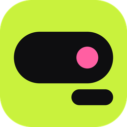
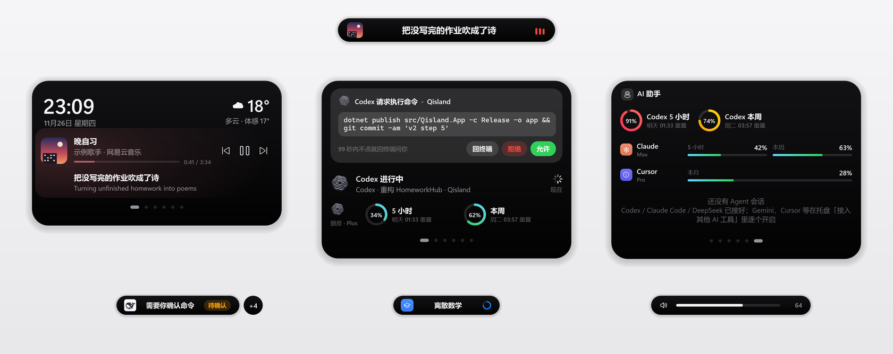
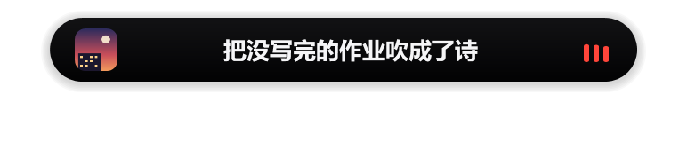
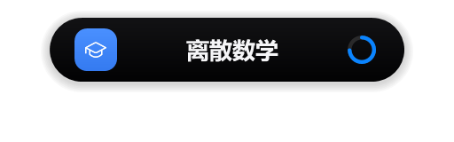
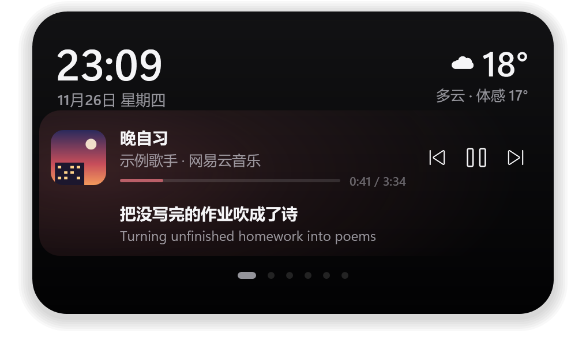
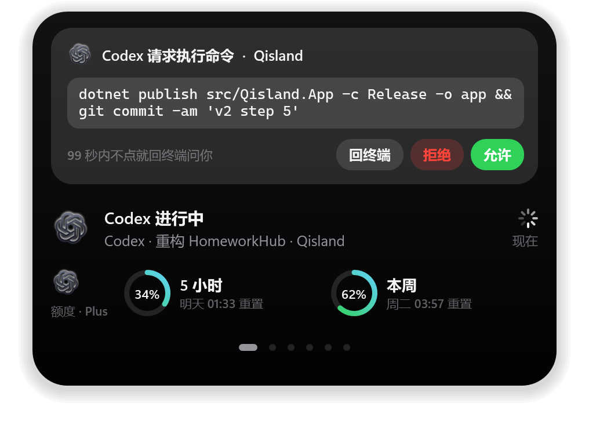
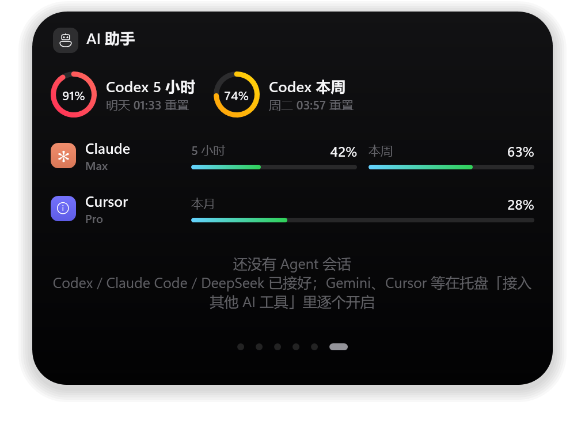

<div align="center">



# Qisland

**A lightweight, native Dynamic Island for Windows, built for developers and students.**


[Download latest](https://github.com/Qiuizi/Qisland/releases/latest) · [Website](https://qiuizi.github.io/Qisland/) · [Changelog (Chinese)](CHANGELOG.md) · [中文](README.md)



</div>

---

Qisland turns a small capsule at the top of your screen into a status bar for the things you would otherwise switch windows to check: an agent waiting for approval, an AI quota running low, a verification code that just arrived, a mouse about to die, a deadline coming up. It shows the time when idle, expands when something happens, and folds back when it's done. Native .NET 8 / WPF with no browser engine; the framework-dependent package is about 9 MB, and everything runs locally.

> The UI is in Chinese for now. Most labels are short and the screenshots below show what each card looks like.

## Highlights

- **Approve Codex / DeepSeek Harness commands on the island.** Click Allow or Deny right on the island; if you don't click within 100 seconds, the request goes back to the terminal. Nothing is ever approved by default. Claude Code only shows a "waiting for you" notice — it cannot be approved from the island.
- **AI coding-tool usage rings** (new in 4.3, off by default). Besides Codex and Doubao, Qisland can read usage percentages for Claude Code, Cursor, Gemini CLI and Kimi Code from the tokens those tools already store locally, alert at 70% / 90%, and optionally show the tightest quota as a ring on the collapsed capsule. These usage endpoints are undocumented; if nothing can be read, nothing is shown. The four tools above are parsed and self-tested against their response formats but have **not yet been verified with real subscription accounts**.
- **Email verification codes** (new in 4.3, off by default). Read-only IMAP (QQ, 163, 126, Gmail, iCloud or a custom server): codes in new mail pop up on the island for one-click copy. Nothing is marked as read, moved or deleted; the app password lives in Windows Credential Manager. So far only tested against a mock IMAP server.
- **Peripheral battery** (new in 4.3). Bluetooth mice, keyboards, controllers and headphones, with alerts at 20% / 10%. Devices whose battery can't be read are hidden.
- **Album-tinted music card** (new in 4.3). A soft glow in the cover's main color behind the card and a matching progress bar, clamped so it never gets garish or hurts text contrast; directional transitions when you skip; word-by-word lyric highlighting when the lyrics carry per-word timing (KuGou local cache, enhanced LRC).
- **Offline city search for weather in China.** Chinese cities are matched from a built-in offline table; overseas cities and forecasts use Open-Meteo, no API key required.
- **Click-through lock.** `Ctrl+Alt+Shift+Q` makes the whole island ignore the mouse, so clicks and scrolling reach the window below; notifications still show.
- **Hide per app.** The island steps aside while listed apps are in the foreground, optionally only when they actually cover it. Fullscreen games and videos already hide it automatically.
- **Hide from screenshots and recordings** (off by default). The island stays visible to you but doesn't appear in screenshots, recordings or screen sharing.
- **Local push API.** One `curl` to `http://127.0.0.1:9840` puts build progress or script results on the island. Listens on localhost only.

## 5.0 preview: DIY, plugins and an installer (unreleased)

The next version is still in development on the main branch; there is no release yet. See the [changelog](CHANGELOG.md) (Chinese) for details.

- **No-code DIY**: a "Layout & DIY" settings page to drag-arrange the collapsed capsule (idle and music layouts) and the widget page, with a live preview. `theme.json` theme packs only need the fields you want to change and are validated on import (colors, contrast, ranges); three official themes are included. Up to 12 quick-action buttons on the widget page.
- **Two plugin tiers**: L2 safe cards are a single `plugin.json` and run no code — Qisland makes the requests itself, only to at most 3 declared public https domains. L3 advanced plugins keep the old process-plugin format: they run a local program with no sandbox and need a separate confirmation. If an update asks for more permissions the plugin is paused until you confirm again. Spec: [plugins/README.md](plugins/README.md).
- **Plugin market**: an offline catalog of the 6 official plugins and 3 themes with one-click install / apply / uninstall. The online index and the revocation list must pass an Ed25519 signature check against the public key built into the app; revoked plugins are disabled with the reason shown. You can add third-party sources, always labelled "third-party · unverified". The index repo template and submission flow live in [plugins/registry-template](plugins/registry-template/README.md); the remote repo does not exist yet.
- **Installer**: alongside the two zips, a `Qisland-<version>-Setup.exe` (Inno Setup) that needs no admin rights, installs to `%LOCALAPPDATA%\Programs\Qisland` by default, offers a desktop shortcut and start-on-login, and keeps your settings on uninstall unless you choose otherwise.

All of this has only been through compilation, self-tests and off-screen screenshots. Drag-and-drop feel, import dialogs, plugins against real APIs, online market refresh and downloads, and actually installing / upgrading / uninstalling with Setup.exe have not been checked by hand yet.

## Screenshots

All screenshots are rendered by the app's own `--snapshot` mode with demo data — no real accounts or messages.

| Collapsed | Expanded |
|---|---|
| <br><br><br><br> |  |
| **Codex approval and quota** | **AI usage page** |
|  |  |

## More

**For students** — class schedule (`.ics`) with reminders and progress; read-only homework deadlines from Yuketang / Chaoxing after QR login (24 / 3 / 1 h reminders); calendar subscriptions (Outlook, Google, Feishu, DingTalk) with one-click meeting links.

**For developers** — an "AI" page that tracks Claude Code, Codex, DeepSeek Harness, Gemini CLI, Cursor, Qwen Code, OpenCode sessions; opt-in integrations that explain exactly which file they change, back it up first and can be undone from the change ledger; selection translation (`Ctrl+Alt+T`) and ask-AI (`Ctrl+Alt+K`) with no key by default or your own key / local Ollama.

**Everyday** — mic / camera in-use dots; call duration for WeChat, QQ, Tencent Meeting, DingTalk, Feishu, Teams, Zoom; music via the system media controls (cover, progress, lyrics, skip); weather, hydration / sitting reminders, to-dos, clipboard, countdowns, file shelf; optional CPU / memory / network on the collapsed capsule; frosted and liquid glass skins; dock to the top, left or right.

## Privacy

- Everything stays on your machine. No server, no uploads, no telemetry.
- WeChat message contents are never read — only the fact that a message arrived.
- No passwords are stored. Yuketang / Chaoxing use QR login only, credentials are DPAPI-encrypted, homework is read-only (no auto sign-in, no auto-watching, no auto-answering).
- Verification codes and clipboard history live in memory only and are never logged.
- AI usage (off by default) only reads tokens the tools already saved locally; it never modifies or refreshes them, and never logs tokens or raw responses.
- Email codes (off by default) open the inbox read-only and never write mail content to disk.
- The local API listens on `127.0.0.1` only.
- Qisland never touches Claude Code's `~/.claude/settings.json`; you run the Claude hook script yourself.

## Install

Windows 10 or 11 (x64). Pick one asset from the [latest release](https://github.com/Qiuizi/Qisland/releases/latest):

| File | For | Notes |
|---|---|---|
| `Qisland-<version>-full-x64.zip` | Most people | Bundles the .NET 8 runtime. Unzip and run `Qisland.exe`. About 80 MB |
| `Qisland-<version>-win-x64.zip` | You already have the [.NET 8 Desktop Runtime](https://dotnet.microsoft.com/download/dotnet/8.0) | About 9 MB |

Unzip into a folder you can write to and run `Qisland.exe`. When a new version is out the island tells you; one click updates in place, each package type updating from the same type, with automatic rollback on failure.

- Codex approval: tray → Codex → "approve Codex requests on the island", or run `scripts\install-codex-hooks.ps1`.
- DeepSeek Harness: install [integrations/dsh-qisland-bridge](integrations/dsh-qisland-bridge).
- Claude Code: run `scripts\install-claude-hooks.ps1` yourself (`scripts/qisland-push` inside WSL2). You'll get a "waiting for you" notice on the island, but approvals stay in the terminal.
- Uninstall: turn off start-on-login in the tray (a scheduled task named Qisland), then delete the app folder and `%APPDATA%\Qisland\`. From 5.0, if you installed with Setup.exe, uninstall it from Windows Settings → Apps; it asks whether to remove your settings and data too.

## Island API

```bash
curl -X POST http://127.0.0.1:9840/v1/island/push \
  -d '{"id":"build","title":"Building","body":"step 3/5","progress":0.6,"type":"info","duration_seconds":30}'
curl -X DELETE http://127.0.0.1:9840/v1/island/push/build
```

See [docs/push-api.md](docs/push-api.md) for all fields and endpoints.

## Known limitations

- Resident memory is dominated by WPF rendering itself and is still being worked on; it varies a lot between machines.
- AI usage for Claude Code / Cursor / Gemini CLI / Kimi Code and email codes have not been verified with real accounts yet — feedback welcome.
- Battery levels depend on what Windows exposes over Bluetooth; some devices report nothing.
- Only tested on a handful of machines. Please open an [issue](https://github.com/Qiuizi/Qisland/issues) if something breaks.

## Build

```powershell
git clone https://github.com/Qiuizi/Qisland.git
cd Qisland
dotnet publish src\Qisland.App\Qisland.App.csproj -c Release -r win-x64 --self-contained false -p:PublishReadyToRun=true -o app
dotnet run --project tests\Qisland.SelfTest
```

Releases are built with `scripts\release.ps1`: two zips, plus a Setup.exe and a SHA-256 list from `installer\Qisland.iss` when [Inno Setup 6](https://jrsoftware.org/isinfo.php) is installed (`-SkipInstaller` to skip, `-DryRun` to rehearse without publishing).

## Credits

Started from [JudeKwong/WinIslands](https://github.com/JudeKwong/WinIslands) (MIT). Many v4 ideas (motion, weather, health, docking, system-composited glass) come from [Daozai](https://github.com/Renly1994/xiaotang-daozai) (MIT), reimplemented in C# / WPF. Interaction ideas also from [dynamic-island-4win](https://github.com/souverth/dynamic-island-4win) and [DynamicWin](https://github.com/FlorianButz/DynamicWin). MIT licensed — see [LICENSE](LICENSE) and [THIRD_PARTY.md](THIRD_PARTY.md).
